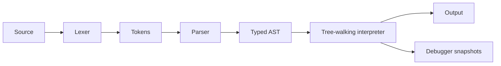

# CodeWeaver

CodeWeaver is an interactive playground for **Weave**, a small interpreted language. Its TypeScript engine uses a handwritten lexer, recursive descent parser, typed AST, nested environments, and a tree-walking interpreter. The React + Vite interface inspects actual tokens and AST nodes, runs programs, and steps through statements while preserving interpreter state.

## Features

- Numbers, strings, booleans, and `null`; declarations, assignment, print, blocks, conditionals, loops, and expressions.
- Arithmetic, comparisons, equality, unary `!` and `-`; parentheses and operator precedence.
- Nested lexical scopes; assignment updates the nearest existing binding.
- Source-positioned lexical, syntax, and runtime diagnostics.
- Configurable interpreter instruction budget (default 10,000 expression and statement operations).
- Run, statement-level Step and Continue, Reset, output, variable snapshots, trace, tokens, and AST inspection.
- Ten runnable examples in the playground.

## Requirements and setup

Requires Node.js 20.19+ or 22.12+ (Vite 8) and npm.

```sh
npm install
npm run dev
```

Open the local URL printed by Vite. Use `npm run test` for Vitest and `npm run build` for the TypeScript check and production bundle.

## Example

```weave
let count = 1;
let total = 0;
while (count <= 5) {
  total = total + count;
  count = count + 1;
}
print(total); // 15
```

## Architecture



Engine modules live in `src/language/`; UI code is in `src/App.tsx`. The interpreter runs AST nodes directly; no JavaScript `eval` or `Function` is used.

### Debugger execution model

`Interpreter.executeIncrementally()` is a generator that executes a statement and yields a trace event only after that statement has changed real interpreter state. Blocks and selected branches are stepped into, and each loop iteration yields its body statements. Environment, output, and execution-budget counters remain in the same interpreter while paused. Continue drains the same generator; Reset creates a new interpreter. Expression and statement work both consume the budget, including work during Step and Continue.

## Examples

Example programs are available in the app and include precedence, variables, loop summation, conditionals, nested scope, strings and booleans, division by zero, undefined names, syntax errors, and infinite-loop protection. Source files are in [`examples/`](examples/).

## Limitations and roadmap

Weave currently has no functions, `return`, `break`, logical `&&`/`||`, arrays, or user-defined operators. `+` accepts two numbers or two strings; other arithmetic and ordering operators require numbers. Conditions use truthiness (`false`, `null`, zero, and empty string are false). Equality requires matching value types. The debugger supports forward statement stepping and snapshots; it does not yet provide breakpoints or step-back.

Roadmap: functions and return; breakpoints and step-back; optional bytecode VM after the language and debugger stabilize.

## Screenshots

_No screenshots included yet._
